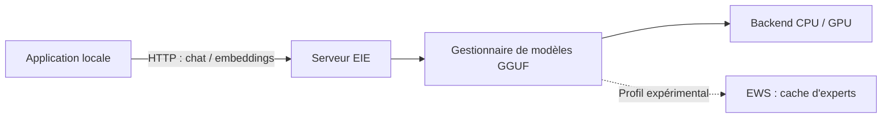

# EIE : Elyne Inference Engine

**Langue : Français · [English](README.md)**

**Un moteur local d'inférence pour les modèles GGUF : conversation, embeddings et exécution configurable de plusieurs modèles.**

EIE est un serveur C++17 publié sous [licence Apache 2.0](LICENSE). Il charge des modèles sur la machine de l'utilisateur et expose une API HTTP dont une partie reprend le format OpenAI. Un seul modèle suffit ; les groupes de modèles sont facultatifs. Le moteur ne fournit pas à lui seul la mémoire, les outils ou l'identité d'une application comme Elyne Next.

## Ce que contient le dépôt

- Le moteur, son serveur HTTP, ses profils de configuration et ses scripts de compilation.
- Des chemins de construction pour Windows, Linux, macOS et Android, dont la qualification varie selon la plateforme.
- Des rapports de mesure et des reçus locaux, avec les limites propres à chaque essai.
- **EWS**, une voie expérimentale qui charge à la demande des poids d'experts pour certains modèles MoE.

Le [README anglais](README.md) décrit l'API, la compilation et la configuration en détail. Le [registre des affirmations](docs/CLAIMS_AUDIT.md) distingue ce qui est implémenté, vérifié localement, rapporté par les mainteneurs ou encore non qualifié. La [feuille de route](docs/ROADMAP_TO_CLAIMS.md) conserve les travaux ouverts.

## Architecture en bref

EIE peut traiter les modèles séparément ou appliquer une stratégie de groupe parallèle, séquentielle ou en éventail. Ces chemins sont implémentés, mais leur fiabilité sous charge n'est pas qualifiée à l'échelle d'une flotte. L'API est un **sous-ensemble** du format OpenAI, sans promesse de compatibilité complète.

## Résultats et limites

| Périmètre | État documenté |
| --- | --- |
| Inférence locale Windows/CUDA et service HTTP | Essais bornés avec modèles réels ; [reçu du service](docs/benchmarks/serving-functional-20260908.md). |
| Inférence Windows/HIP sur AMD Radeon 8060S | EIE compilé et exécuté sur le GMKtec EVO-X2 : deux requêtes par modèle pour Gemma 12B, Bonsaï 27B et Nomic, avec toutes les couches sur `ROCm0`. [Rapport et limites](docs/benchmarks/x2-amd-20261123.md). Ce résultat ne qualifie ni Linux/ROCm, ni EWS sur AMD, ni la coexistence des modèles. |
| Elyne Next, modèle résident 12B et auxiliaire 26B via EWS | Aller-retour réel de l'application observé localement ; le résultat ne qualifie pas toute sa durée de vie ni un déploiement à grande échelle. |
| EWS sur Gemma 26B | Consommation effective des poids chargés et coexistence avec Next vérifiées dans les profils publiés ; [rapport](docs/benchmarks/ews-consumed-20260905.md). |
| EWS sur GLM | Voie expérimentale distincte, avec contrôles numériques et aller-retour Next bornés ; aucune généralisation à tous les modèles MoE. |
| Android arm64 | Bundles CPU `dotprod` et `i8mm` essayés avec Gemma sur Galaxy Z Flip6 ; [reçu et limites](docs/benchmarks/android-neon-zflip6-20260914.md). Ce n'est ni une application Android complète ni une qualification NPU/GPU. |
| Apple Silicon | Fonctionnement et mesures sur MacBook Pro rapportés par les mainteneurs ; [conditions](docs/benchmarks/macos-apple-silicon-20260913.md). Aucune réplication indépendante revendiquée. |

Les anciennes comparaisons générales de vitesse et de VRAM avec Ollama ont été **retirées** : elles ne reposaient pas sur des versions, configurations et mesures brutes appariées. Les résultats EWS d'août et de septembre décrivent des chemins différents et ne doivent pas être fusionnés.

## Pour démarrer

Consultez le [guide Windows](docs/windows.md), le [guide macOS](docs/macos.md), les [composants Android](mobile/README.md) ou les [instructions EWS](docs/ews/runtime-port.md), selon la plateforme. Les poids des modèles et l'application Elyne Next ne sont pas inclus dans ce dépôt.

## Licence et contact

EIE est publié sous [Apache 2.0](LICENSE), avec les notices tierces du dépôt. Pour une intégration ou un échange technique : [Elyne Corp](https://elynecorp.fr) · [admin@elynecorp.fr](mailto:admin@elynecorp.fr).
